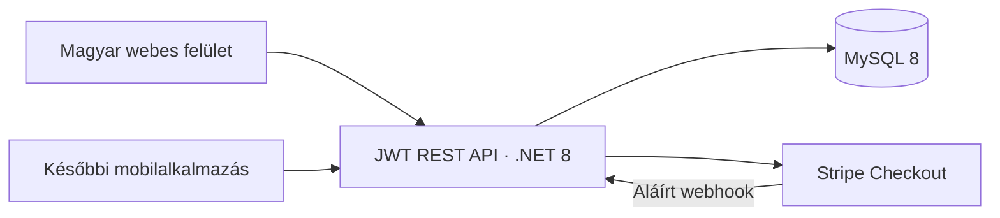

# Architektúra és üzleti invariánsok

A webes felület natív JavaScript-modulokból és CSS-ből áll. Az API-adapter választja el a felhasználói felület millió forintban megjelenített adatait az API teljes HUF-összegeitől. A telefonos kliens ugyanazokat a végpontokat használhatja; a backend nem függ a webes felülettől.

A felhasználó 1:N kapcsolatban áll az ingatlanokkal és a keresési igényekkel. Az aktív entitás kizárólag a munkafolyamatot választja ki; a tulajdonosi jogosultságot minden módosító kérés külön ellenőrzi. Ingatlan és keresési igény között oldalanként legfeljebb egy végleges döntés szerepel. A kölcsönös kedvelésekből egyedi párosítás lesz, ehhez tartoznak az üzenetek.

Az ajánló két szakaszt használ. A helyszín és az ingatlantípus kizáró feltétel, ahogy az archiválás, saját tulajdon, közvetítő–közvetítő kapcsolat és az adott oldal korábbi döntése is. Minden további megadott feltételt teljesítő pár 100%-os. Előbb az összes még el nem bírált pontos találat fogy el, az 50 kártyás válaszméreten túl is. Ezután a felület külön rákérdez a részleges találatokra. Az engedély az aktív entitáshoz és annak aktuális feltételeihez tartozik. A backend a részleges döntést is ellenőrzi: explicit `allowApproximate=true` és a pontos találatok elfogyása szükséges.

Keresőként az egyezési százalék csökkenő sorrendje az elsődleges; egyforma százaléknál előbb a már beérkezett kedvelések, majd a jobb ár-érték arány jön. Eladóként az adott szakaszon belül a beérkezett kedvelés az elsődleges, azon belül az egyezési százalék, végül a keresés specializáltsága dönt. A stabil azonosító-sorrend csak az összes üzleti szempont egyezésekor lép életbe.

Az eladói kedvelés tranzakcióban zárolja a felhasználó egyenlegét, az ingatlan és a keresési igény sorát, majd ugyanebben a tranzakcióban hozza létre a döntést, a naplóbejegyzést és adott esetben a párosítást. Az egyedi indexek a döntéspárt és a párosítást adatbázisszinten is védik. Ismételt azonos kérés nem von le újabb kreditet. Ellenkező döntés újraküldése ütközés.

A nyilvános DTO-k nem tartalmaznak felhasználói e-mail-címet, telefonszámot vagy pontos címet. Kontaktot kizárólag a saját párosítások végpontja ad vissza. A beírt publikus szövegek közismert e-mail- és magyar telefonszámformátumait a backend elutasítja; a képek vagy szándékosan elfedett kontaktadatok felismerése nincs megvalósítva.

A fizetési rendelés ára és kreditmennyisége szerveroldali. A visszatérési URL nem jogosít kreditre. A webhook aláírásának, időbélyegének, rendelésének, munkamenetének, felhasználójának és összegének ellenőrzése után a jóváírás egyetlen tranzakcióban történik. A rendelés credited állapota és az egyedi naplóazonosító ismételt webhook esetén is kizárja a dupla jóváírást.

## Egyezési százalék és rangsorolási mutatók

A százalék nem kap alappontot. Csak a megadott, az adott ingatlantípusnál alkalmazható feltételek súlya vesz részt a számításban. Minden feltételhez 0–1 közötti eltérést számolunk, majd:

`egyezés = 100 × (1 − súlyozott eltérések összege / aktív súlyok összege)`

A teljes feltételteljesítés pontosan 100; minden részleges találat legfeljebb 99, akkor is, ha a kerekítés önmagában 100-at eredményezne. Az érték 0-ig csökkenhet. Ismeretlen adat egy kért feltételnél teljes eltérés. Üres korlát vagy választék nem kérhető számon.

| Feltétel | Súly | Eltérés számítása |
|---|---:|---|
| Maximumár | 32 | Kerettúllépés / maximumár |
| Minimum szobaszám | 22 | Hiányzó szobaszám / minimum |
| Minimum alapterület | 16 | Hiányzó alapterület / minimum |
| Állapot | 10 | A legrosszabb elfogadotthoz képesti visszalépés / 3 fokozat |
| Emelet | 7 | A legközelebbi elfogadott emelettől való távolság / 5 emelet |
| Lift | 5 | Kért, de hiányzik: teljes eltérés |
| Erkély | 4 | Kért, de hiányzik: teljes eltérés |
| Falazat | 3 | Egyik elfogadott opció sem teljesül: teljes eltérés |
| Főfűtés | 2,5 | Egyik elfogadott opció sem teljesül: teljes eltérés |
| Építési korcsoport | 2 | Távolság a legközelebbi elfogadott korcsoporttól / 4 |
| Belmagasság | 1,5 | Eltérő kategória: teljes eltérés |
| Maximum alapterület | 1,25 | Túllépés / maximum |
| Maximum szobaszám | 1 | Túllépés / maximum |
| Minimumár | 0,75 | Elmaradás / minimum |
| Kilátás | 0,5 | Egyik elfogadott opció sem teljesül: teljes eltérés |

Minden eltérést legfeljebb 1-re korlátozunk. A feltételen belüli több választás alternatíva. Állapotnál a sorrend felújítandó → átlagos → jó → új/felújított; a minimumként elfogadottnál jobb állapot teljesen megfelelő. A 11. emelet választása továbbra is a 11. és afölötti emeleteket jelenti. Háznál az emelet, lift és erkély nem vesz részt a számításban.

Az ár-érték mutató alapja az alapterület osztva a millió forintban megadott árral. Háznál a telek minden négyzetmétere 0,04 négyzetméter lakóterületnek számít, de a telek hozzájárulása legfeljebb a lakóterület 20%-a. Ezt legfeljebb 25%-os, dokumentált minőségi bónusz módosítja: állapot, falazat, épületkor, kilátás, fűtés, szigetelés, energetika, légkondi, napelem, parkolás és további felszereltség. Ez rangsorolási becslés a megadott adatokból, nem piaci értékbecslés.

A specializáltság külön, 0–100 közötti mutató. A kitöltött feltételek, a szűkebb számtartományok, a kevesebb elfogadott opció, a jobb minimumállapot és a kisebb helyszínlefedettség növeli. Nem függ a pillanatnyi hirdetésszámtól, ezért ugyanaz a keresés változatlan feltételekkel stabil értéket kap.

A backend és a böngészős demó ugyanazokat a súlyokat és képleteket használja. Az API HUF-összegeit és a demó millió forintos értékeit a relatív eltéréseknél azonos egységen belül kezeljük. A számításhoz előkészített szűrőhalmazok újrahasználhatók.

## Lekérdezési költség

Az SQL már a típus, helyszín, archiválás, tulajdonos/fióktípus és korábbi döntések alapján szűkít. Az elbírált párok kizárása korrelált `NOT EXISTS`, nem növekvő kliensoldali azonosítólista. A rangsorolás szűk mezőkészletet olvas és legfeljebb 50 pontos, illetve 50 részleges jelöltet tart meg; a teljes leírások és képhivatkozások csak a ténylegesen visszaadott kártyákhoz töltődnek be. A döntés előtti jogosultsági vizsgálat korán megállhat az első pontos jelöltnél. Az összetett indexek additív sémafrissítéssel kerülnek a meglévő adatbázisra.

Az eladói irányban a keresések kiválasztott helyszínei külön `SearchLocations` táblában, `(LocationId, SearchRequestId)` lefedő indexszel szerepelnek. Egy városkörnyék egyetlen kiválasztott azonosító marad. Az index mentéskor atomikusan frissül; a meglévő keresések 500-as csomagokban kapnak visszatölthető indexet az additív sémafrissítés alatt. Az átfedő város/kerület/városkörnyék ugyanazt a keresést egyszer adja vissza. A rangsorolás és a kártyaadatok olvasása közös RepeatableRead pillanatképet használ.
