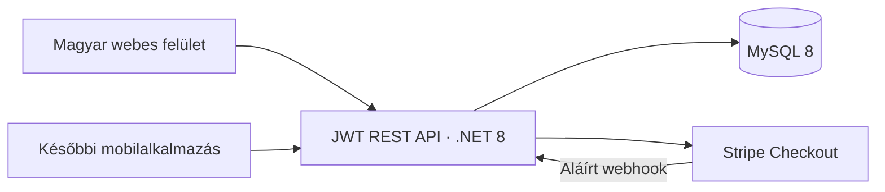

# Architektúra és üzleti invariánsok

A webes felület natív JavaScript-modulokból és CSS-ből áll. Az API-adapter választja el a felhasználói felület millió forintban megjelenített adatait az API teljes HUF-összegeitől. A telefonos kliens ugyanazokat a végpontokat használhatja; a backend nem függ a webes felülettől.

A felhasználó 1:N kapcsolatban áll az ingatlanokkal és a keresési igényekkel. Az aktív entitás kizárólag a munkafolyamatot választja ki; a tulajdonosi jogosultságot minden módosító kérés külön ellenőrzi. Ingatlan és keresési igény között oldalanként legfeljebb egy végleges döntés szerepel. A kölcsönös kedvelésekből egyedi párosítás lesz, ehhez tartoznak az üzenetek.

Az ajánló először a település, kerületlista, típus, ár, alapterület, szobaszám és szükséges felszereltség alapján szűr. A pontozás csak a megfelelők sorrendjét befolyásolja. Saját tulajdonú párokat és az aktív oldalról korábban elbírált párokat nem ad vissza. A jelen első verzió a jelöltek egy részét memóriában szűri; nagy adatbázisnál a szűrés SQL-be tolása és lapozás szükséges.

Az eladói kedvelés tranzakcióban zárolja a felhasználó egyenlegét, az ingatlan és a keresési igény sorát, majd ugyanebben a tranzakcióban hozza létre a döntést, a naplóbejegyzést és adott esetben a párosítást. Az egyedi indexek a döntéspárt és a párosítást adatbázisszinten is védik. Ismételt azonos kérés nem von le újabb kreditet. Ellenkező döntés újraküldése ütközés.

A nyilvános DTO-k nem tartalmaznak felhasználói e-mail-címet, telefonszámot vagy pontos címet. Kontaktot kizárólag a saját párosítások végpontja ad vissza. A beírt publikus szövegek közismert e-mail- és magyar telefonszámformátumait a backend elutasítja; a képek vagy szándékosan elfedett kontaktadatok felismerése nincs megvalósítva.

A fizetési rendelés ára és kreditmennyisége szerveroldali. A visszatérési URL nem jogosít kreditre. A webhook aláírásának, időbélyegének, rendelésének, munkamenetének, felhasználójának és összegének ellenőrzése után a jóváírás egyetlen tranzakcióban történik. A rendelés credited állapota és az egyedi naplóazonosító ismételt webhook esetén is kizárja a dupla jóváírást.
